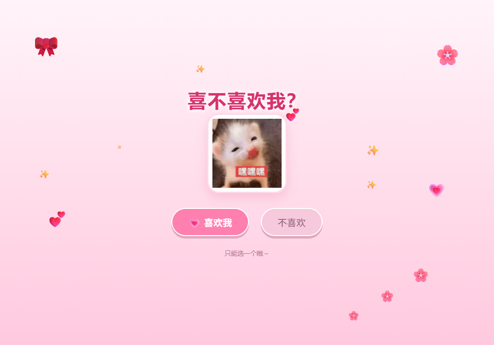

# like-me-prank · 「喜不喜欢我？」

A tiny single-file web prank: a cute "Do you like me?" page where every "No" makes the button shrink and the mascot sadder — until "Yes" launches a canvas fireworks page with a 王者荣耀-style "敌军还有 5 秒到达战场" countdown. Built for scanning a QR code in WeChat/QQ.

一个单文件网页小恶作剧：点「不喜欢」→ 表情越来越委屈、按钮越缩越小；点「喜欢我」→ 烟花页 +「敌军还有 5 秒到达战场」倒计时。原本是托管后生成二维码用微信扫码玩的。



## 玩法

- **不喜欢**：每点一次换下一张表情 + 换一句台词，按钮同时缩小一圈，翻完就点不动了
- **喜欢我**：跳转到烟花页，贴纸像烟花一样炸开，5 秒倒计时结束后显示「上号！」
- 页面没有退出按钮（微信里返回即可退出）

## 使用

### 本地直接玩

双击 `docs/index.html`，浏览器打开即可（贴图已全部 base64 内嵌，零外部依赖）。

### 托管 + 二维码

1. 把 `docs/` 传到任意静态托管（GitHub Pages / 自己的服务器 / 对象存储都行；本仓库已配好 Pages，直接推 main 即可）
2. 生成二维码：

```bash
pip install qrcode pillow
python3 tools/make_qr.py "https://你的地址/"
# 或把二维码融合进一张插画底图：
python3 tools/make_qr_merged.py "https://你的地址/" 底图.png
```

产物在 `docs/qrcode.png` / `docs/qrcode_merged.png`（已 gitignore）。

### 改台词 / 换表情

编辑 `src/build.py` 顶部：

```python
PET_FILES       = [...]   # 「不喜欢」依次翻的主角表情（按顺序）
DISLIKE_TEXTS   = [...]   # 每次点击弹出的台词
MOOD_EMOJI      = [...]   # 表情旁的 emoji
FIREWORK_STICKERS = [...] # 只在烟花页炸开的贴纸
COUNTDOWN_FROM  = 5       # 倒计时秒数
```

然后重新打包：

```bash
python3 src/build.py        # 生成 docs/index.html
```

## 源码结构

```
like-me-prank/
  docs/index.html       ← 打包好的单文件网页（可直接托管，也是 GitHub Pages 的源）
  src/template.html     ← 页面模板（CSS/Canvas/逻辑）
  src/build.py          ← 把贴图 base64 内嵌进模板
  assets/pet/           ← 主角表情 GIF
  assets/sticker/       ← 上飘的小贴纸 PNG
  tools/make_qr.py      ← 链接 → 二维码
  tools/make_qr_merged.py ← 链接 + 底图 → 融合二维码
```

## 注意

- 纯娱乐用途。请勿用于骚扰、诈骗或让对方不适的场合。
- 仓库里的表情/贴纸来自网络聊天表情，仅作演示；如果要公开发布或商用，请换成你有权使用的素材。
- 页面不联网、不采集任何数据（除你自己的静态托管外没有任何请求）。

## License

MIT（代码部分；`assets/` 下的表情图片版权归原作者，仅供演示，请自行替换）
